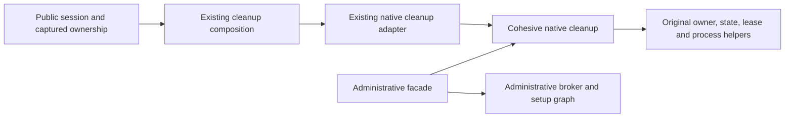

# Native cleanup loading

Public session cleanup remains synchronous. Its native adapter imports the cohesive `device-lab-cleanup` module instead of the larger administrative CLI module. The administrative facade imports shared helpers and reexports its existing owner identity, backend table and cleanup function; those exports retain the same objects and function identities.

The cleanup module keeps native owner reads, mutation and operation locks, current-record comparison, physical leases, Windows singleton generation checks, process identity, provider stop commands and bounded process waiting together. Device failure reporting, container shutdown failure and retryable ownership receipts retain their existing order and authority. This extraction adds no cleanup channel, asynchronous workflow, runtime selection rule or timeout.

The guardian already sends its readiness acknowledgement before dynamically importing terminal cleanup composition. The public session import boundary and guardian terminal cleanup boundary are separate. This change does not make the whole CLI informational import graph lightweight.

Before extraction, the original source and native modules, function bodies, complete administrative declarations and emitted payload were frozen against the original Git revision. Instrumented launches of the same byte-identical original payload differed between the owned v9fs location and an owned `/tmp` copy. Those observations identify stages and location sensitivity; they do not establish the cause of historical test failures or promise a timeout improvement. Existing readiness and cleanup budgets remain unchanged.

Review and QA must verify original versus extracted native behavior, retained administrative exports and declarations, real public session/captured-ownership callers, and both actual shipping payloads. Controlled low-level probes prove wiring and authority preservation; they do not establish acceptance on real native providers, operating systems or container engines. No additional architecture operation is credited for moving these helpers.

The ordinary regressions and distribution checker use a tracked, data-only original witness instead of an ignored Task directory. It contains the authentic EFC runtime closure (46 JS/MJS files), the complete declaration closure (52 files, including private carriers and namespace reexports), three original package manifests, and all 47 function plus nine data/type body records. Each original file retains its exact bytes and SHA256. The witness is deeply immutable and performs no filesystem, compiler or native work when imported.

Each test controller materializes these 101 original files lazily in its own authenticated temporary directory. Original reads verify registered paths, ordinary ancestors, inode identity, descriptor ownership, byte bounds and hashes. The compiler checks the genuine declarations with `skipLibCheck=false` and resolves original package aliases within the original tree. Actual candidate modules still come from current source or the extracted shipping payload; the witness supplies independent original authority and cannot substitute for candidate code.

The complete 687-file capture remains a separate admission requirement. Set `CCC_NATIVE_CLEANUP_ADMISSION_REPLAY=1` explicitly for the original boundary replay; unavailable or corrupt admission evidence fails that replay. Ordinary tests and both shipping consumers use the durable 101-file closure with Task/admission unavailable. These are distinct proof layers: the bounded witness does not claim to reauthenticate all 687 files during a default run.

Prepared source and dual-payload results remain evidence for their recorded inputs. The durable-fixture change requires fresh review and Task-absent source/emitted and dual-shipping verification before acceptance. It changes no production cleanup, public API, backend policy, native effect fence, readiness deadline or architecture-operation count.
